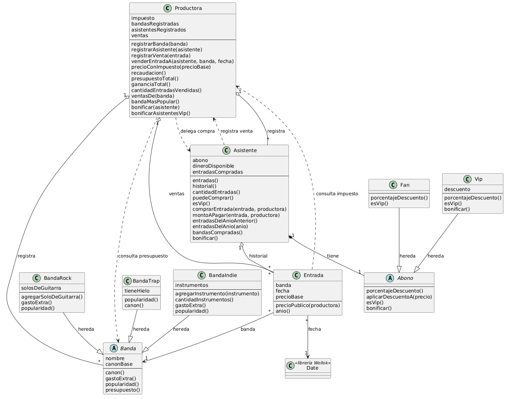

# PDEP Entertainment - TP individual de Objetos

Ignacio Gabriel Álvarez

El diagrama también está en `diagrama_solucion_Ignacio_Alvarez.puml`.

## Decisiones de diseño

- El impuesto es un porcentaje que guarda la productora y se aplica al precio base de cada entrada.
- El descuento vip se calcula sobre el precio público, es decir, precio base más impuesto. El abono fan no tiene descuento.
- Para comprar, el asistente necesita saldo mayor a cero. Después de la compra puede quedar con saldo negativo.
- La productora registra cada venta y calcula sus reportes sobre ese registro.
- La recaudación usa el precio público sin descontar el beneficio vip, porque esa diferencia la cubren los sponsors.
- El canon de trap es 1.000.000 multiplicado por la popularidad. Para la banda más popular usé la cantidad de entradas vendidas, no el método `popularidad()`.
- “Año anterior” significa el año calendario anterior. Los nombres de las bandas compradas se devuelven sin repetir.
- Bonificar un abono vip aumenta su descuento en un punto porcentual.

## Conceptos aplicados

1. **Objetos y mensajes:** la productora le envía `comprarEntrada` al asistente, y el asistente les envía mensajes a la entrada, al abono y a la productora. Cada objeto se encarga de una parte de la compra.
2. **Herencia:** `Banda` es la superclase de `BandaRock`, `BandaTrap` y `BandaIndie`; `Abono` es la superclase de `Fan` y `Vip`. Las subclases reutilizan lo común y cambian solo lo que necesitan.
3. **Polimorfismo:** `popularidad()`, `canon()`, `gastoExtra()`, `porcentajeDescuento()` y `bonificar()` se comportan distinto según el tipo de banda o de abono. La productora y el asistente trabajan con todos de la misma forma.
4. **Encapsulamiento:** el dinero, el historial, las ventas, los descuentos y los datos de las bandas son estado interno y se consultan o modifican mediante métodos. La compra se resuelve en `Asistente.comprarEntrada` para mantener todo consistente.
5. **Composición y colecciones:** la productora contiene bandas, asistentes y ventas; el asistente contiene un abono y su historial. Los reportes se arman recorriendo esas colecciones con `filter`, `map`, `sum`, `count` y `max`.
